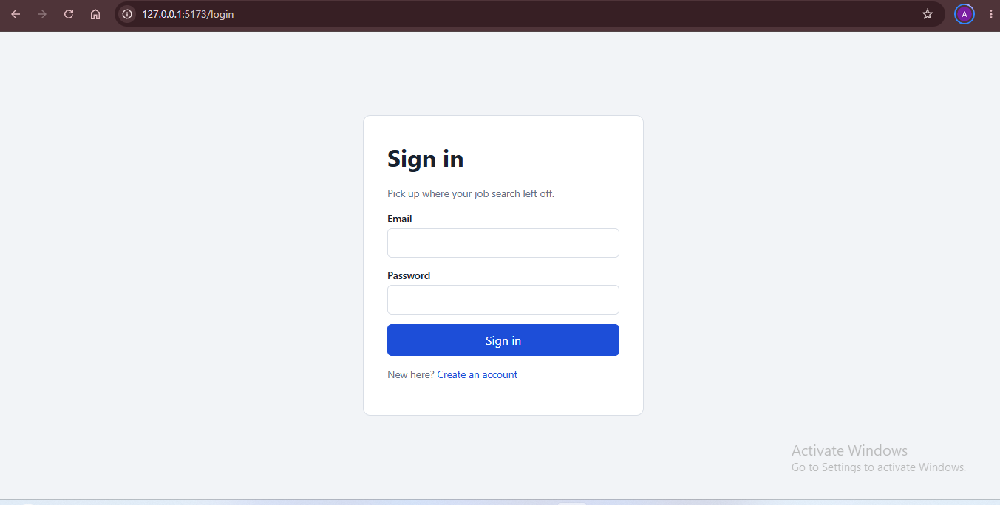
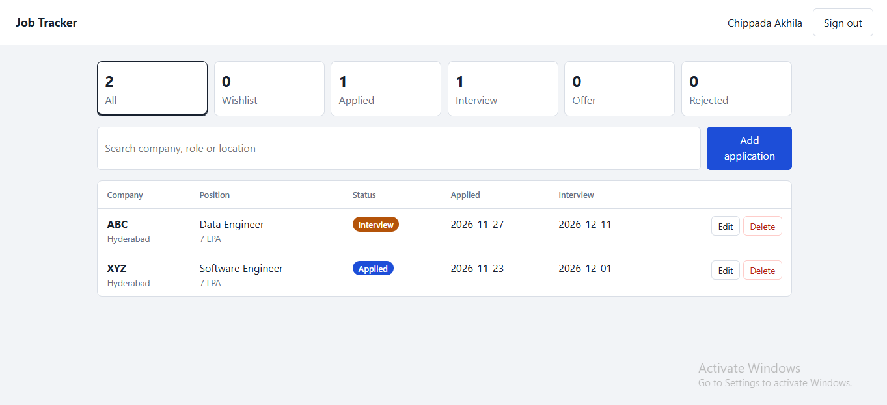

# Job Tracker (React + Node/Express + MySQL + JWT)

Track job applications, interview dates and statuses in one place.

## Screenshots







## Requirements
- Node.js 18+ and npm
- MySQL 8 running locally

## 1. Backend
```
cd backend
npm install
```
Copy `backend/.env.example` to `backend/.env` (Windows: `copy .env.example .env`), then set `DB_PASSWORD` to your MySQL password and change `JWT_SECRET`.
```
npm start
```
The server creates the `job_tracker` database and tables automatically (same SQL is in `database/schema.sql`).
API runs on http://localhost:5000

## 2. Frontend (new terminal)
```
cd frontend
npm install
npm run dev
```
Open http://localhost:5173, register an account and start adding jobs.

## API
| Method | Route | Auth | Purpose |
|---|---|---|---|
| POST | /api/auth/register | no | create account |
| POST | /api/auth/login | no | get JWT |
| GET | /api/auth/me | yes | current user |
| GET | /api/jobs?status=&search= | yes | list jobs |
| GET | /api/jobs/stats/summary | yes | counts per status |
| GET/PUT/DELETE | /api/jobs/:id | yes | read, update, delete |
| POST | /api/jobs | yes | create job |

## Troubleshooting
- `ECONNREFUSED` / `Access denied`: MySQL is not running or `DB_PASSWORD` in `backend/.env` is wrong.
- Port 5000 busy: change `PORT` in `backend/.env` and the proxy target in `frontend/vite.config.js`.
